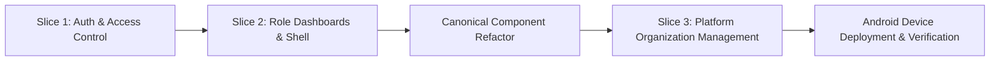

# WorkAxis Implementation Summary & Status Report

**Document Date:** November 15, 2026 (status refreshed; original October 18, 2026)  
**Application:** WorkAxis Unified Enterprise Platform  
**Target Form Factors:** Android Smartphone, Android Tablet, Responsive Web Browser  
**Status:** All feature slices run against the real backend (Firebase project `workaxis-app`). Mock repositories remain for tests and the `mock` backend mode. See Sections 4 and 5.

---

## 1. Executive Summary

WorkAxis is a single, unified Flutter application designed to serve five distinct organizational roles without maintaining separate customer and platform-console codebases:
1. **Platform Owner** (Platform-level administration and administrator management)
2. **Platform Administrator** (Customer organization provisioning and operations)
3. **Organization Admin** (Single customer organization management and user provisioning)
4. **Branch Manager** (Operational management across assigned branches with mandatory active branch context)
5. **Employee** (Self-service attendance, shifts, and operational activities)

The project was built **mock-first**: UI and business rules sit behind domain contracts, with mock repositories for tests and the `mock` backend mode. The real implementations are now wired (Section 5): Firebase Authentication, PostgreSQL reached only through Cloud Functions (`dataOp`), Firestore for event data, and Cloud Storage for attachments.

---

## 2. Architectural Foundations

### 2.1 Layered Architecture
- **Presentation Layer**: Pure Flutter widgets, adaptive layout builders, and `ChangeNotifier` state controllers. No raw database queries or direct infrastructure calls in widget trees.
- **Domain Layer**: Pure Dart entities (`CustomerOrganization`, `OrganizationAdminUser`, `OrganizationStatus`, `UserRole`, `BranchContext`), value objects, and repository interfaces.
- **Data Layer**: Mock repositories and data sources providing realistic data models, delay simulations, and error states.

### 2.2 Navigation & Application Context
- Centralized routing powered by `GoRouter` (`app_router.dart`, `app_routes.dart`).
- Centralized auth guards redirect unauthenticated sessions to `/sign-in` and enforce role boundaries.
- Context-aware routing: Branch Managers assigned to multiple branches are prompted to select an active branch (`/select-branch`) before entering branch-scoped operations (`/branch`).

### 2.3 Canonical UI Design System
To ensure strict visual fidelity with Google Stitch designs and prevent ad-hoc UI duplication, canonical templates have been established and enforced:
- **`AppPageHeader`**: Standardized header with breadcrumb hierarchy, entity avatar/badge, page title, subtitle, and responsive action button toolbar.
- **`AppButton`**: Primary, secondary tonal, outlined, and `.responsive()` variants adapting full-width on mobile and intrinsic width on tablet/desktop.
- **`AppTextField` & `AppPasswordField`**: Outlined M3 inputs with structured labels, helper/error text, and `.search()` factory.
- **`AppKpiCard`**: Canonical 3-row KPI card (Top Row: title + icon box; Middle Row: 36px bold metric + inline badge; Bottom Row: status indicator dot + metadata).
- **`ResponsiveKpiSection`**: Multi-form-factor KPI presenter (swipeable full-width carousel on smartphone `<600dp`, 2-column grid on tablet `600-839dp`, single-row flex on desktop `>=840dp`).
- **`StatusChip`**: High-contrast operational badge with 6px status indicator dot (`active`, `pending`, `urgent`, `neutral`).
- **`AdaptiveAppShell`**: Responsive application shell with centered WorkAxis branding, hamburger drawer on phone/tablet, persistent sidebar on desktop, notification bell, and user profile popup menu.

---

## 3. What Has Been Done So Far

### 3.1 Vertical Slice 1 — Authentication & Access Control
- **Multi-Role Identifier + Password Authentication**: Single login screen (`SignInScreen`) supporting username, email, or phone number aliases across all five roles.
- **Role-Based Provisioning & Routing**: Validated credentials route automatically to the appropriate workspace:
  - `platformowner` / `password123` → Platform Owner Console (`/platform`)
  - `platformadmin` / `password123` → Platform Administrator Console (`/platform`)
  - `orgadmin` / `password123` → Organization Dashboard (`/organization`)
  - `manager` / `password123` → Branch Manager Flow (Branch Selector `/select-branch` → `/branch`)
  - `employee` / `password123` → Employee Home (`/employee`)
- **Multi-Branch Context Switching**: Enforces branch isolation for Branch Managers. When assigned to multiple locations, managers select an active branch, which propagates through the application state.

### 3.2 Vertical Slice 2 — Role Dashboards & Adaptive Shell
- **Platform Overview (`PlatformHomeScreen`)**: Multi-tenant metrics (*Total Organizations*, *Active Hubs*, *Personnel Monitored*, *System Health*), KPI carousel, and recent customer organizations summary.
- **Organization Overview (`OrganizationHomeScreen`)**: Organization Admin dashboard featuring attendance KPI carousel (*Present Today*, *Late*, *Absent*, *On Leave*), shift target adherence bar, and key branch snapshots.
- **Branch Overview (`BranchHomeScreen`)**: Branch Manager operational screen scoped to active branch context, showing real-time roster adherence, shift distribution, and operational actions.
- **Employee Home (`EmployeeHomeScreen`)**: Touch-friendly self-service kiosk with interactive clock-in/out action card, shift timer, and daily schedule.
- **Adaptive Navigation Refactor**:
  - Moved bottom buttons into a collapsible left-side drawer on smartphone and tablet.
  - Centered WorkAxis logo branding in top bar.
  - Added hamburger toggle button in the top left.
  - Replaced standalone sign-out button with an interactive profile avatar popup menu in the top right.

### 3.3 Canonical Component Refactor & Rule Codification
- Refactored all KPI implementations to use `AppKpiCard` and `ResponsiveKpiSection`.
- Centralized button layouts into `AppButton` and input forms into `AppTextField`.
- Updated `AGENTS.md` and `STITCH_FIDELITY_RULES.md` with strict, non-negotiable rules governing component decomposition, inline badge positioning, semantic colors, and carousel behavior.

### 3.4 Vertical Slice 3 — Platform Organization Management
Implemented four production-quality screens for Platform Owner / Administrator workspaces based on approved Google Stitch designs (`projects/600623576580245702`):

#### 1. Organizations List Screen (`OrganizationsListScreen`)
- **Route**: `/platform/organizations`
- **Catalog Search**: Real-time filtering by organization name or code (e.g. "Apex", "ORG-APX").
- **Status Filter Chips**: Segmented chips with live item counts (*All*, *Active*, *Suspended*).
- **Multi-Form Factor Layout**:
  - *Smartphone (<600dp)*: Touch-ergonomic card list (`OrganizationCardItem`).
  - *Tablet (600–839dp)*: Balanced 2-column responsive grid.
  - *Desktop (>=840dp)*: Structured data table (`OrganizationsTable`) with initials avatar, tenant code in mono font, status chip, branch count badge, staff tally, onboarded date, and quick action buttons. Safeguarded with horizontal scrolling on compact desktop viewports.
- **States Handled**: Loading, empty state with "Create Organization" call-to-action, and "No matching results" with one-tap filter reset.

#### 2. Organization Details Screen (`OrganizationDetailsScreen`)
- **Route**: `/platform/organizations/:id`
- **Header & Navigation**: Breadcrumb back to list, entity avatar, active/suspended status chip, and contextual actions (*Edit Organization*, *Suspend* / *Reactivate*).
- **Canonical KPI Cards**: *Total Branches* and *Total Employees* with inline ratios.
- **Organization Information Panel**: Core organizational metadata, tenant code, verified entity badge, physical address, and operational contact lead (name, email, phone).
- **Organization Administrators Panel**: Read-only directory of assigned administrative users displaying avatar initials, full name, role badge, contact links, and last active timestamp. Includes an empty state for organizations with no assigned administrators (e.g. *Crestline Cold Storage*).
- **Suspend & Reactivate Modals**: M3 confirmation dialogs (`SuspendOrganizationDialog`, `ReactivateOrganizationDialog`) with reason code selection, impact warnings, error recovery, and simulated backend updates.

#### 3. Add Organization Screen (`AddOrganizationScreen`)
- **Route**: `/platform/organizations/add`
- **Two-Section Form**:
  - *Organization Profile*: Organization Name, Unique Tenant Code, Physical Headquarters Address, Operational Description.
  - *Operational Contact*: Lead Contact Person, Corporate Email, Phone Number.
  - *Form Validation*: Mandatory name and code, minimum 3 alphanumeric characters for code, RFC-compliant email regex, and real-time duplicate code collision rejection against existing tenants.
- **Responsive Footer**: Tenant database encryption notice and primary submission action with loading indicators.

#### 4. Edit Organization Screen (`EditOrganizationScreen`)
- **Route**: `/platform/organizations/:id/edit`
- **Pre-Populated Form**: Pre-fills existing organizational metadata with immutable tenant code.
- **Dirty State Tracking**: Real-time change detection showing an "Unsaved Changes" indicator.
- **Discard Confirmation**: `DiscardChangesDialog` modal intercepting back-navigation and cancel actions to prevent accidental data loss.

---

## 4. Quality & Verification

Last verified 2026-11-15: `dart format lib test` clean, `flutter analyze` reports no issues, and `flutter test` passes (888 tests). Earlier counts in this document (99 tests, Slice 1-7 browser smoke review) are historical and no longer apply.

---

## 5. Current Implementation Scope

### Backend (current)

- **Relational data:** plain PostgreSQL, reached only from Cloud Functions through `SqlExecutor` (`functions/src/db`). The app calls one callable, `dataOp`, through `DataGateway` (`lib/core/backend/data_gateway.dart`). Firebase Data Connect and the generated client have been removed. Schema and seed: `functions/db/migrations`, `functions/db/seed/seed_data.sql`.
- **Account and organization operations:** typed callables in `lib/core/backend/account_callables.dart` (provision, update, reset password, set status, `deleteOrganization`).
- **Firebase project:** `workaxis-app` (Auth, Firestore, Storage, Hosting, Functions in asia-south1).
- **Attachments and photos:** uploaded through `AttachmentStorage` (`lib/core/storage`), backed by Cloud Storage. Records saved before the upload change may still hold local device paths.
- **Employee home location:** loading and refreshing the screen only reads location permission state. The OS permission prompt appears only from an explicit user action (the geofence refresh button or a punch).

### Fixed in the 2026-11-15 review pass

- Employee home no longer triggers the location prompt on load or refresh (`AttendanceLocationProvider.peekLocation`).
- `AccessController.refreshAccess` skips non-forced refreshes within 60 seconds of the last resolve; pull-to-refresh and post-mutation refreshes remain forced.
- Organization details actions and organization list cards fit 360dp at 1.3x text with 48dp touch targets.
- Deleting an organization navigates to the list without a "not found" flash, updates the list and counts locally, and then reconciles with the server. The SQL-backed repository calls the `deleteOrganization` callable through `AccountCallables`.
- Test detection (`isHeadlessTest`) was removed from production code; maps read an injected `MapRenderingScope`.

### Known gaps

- Kiosk pairing codes and pairing state are in-memory only.
- Test-only: mock member profiles cannot sign in; real accounts are created through `provisionUser`.
- Decommissioning of the old WorkAxis functions and hosting in the previous Firebase project is pending (see `HANDOFF.md`).
